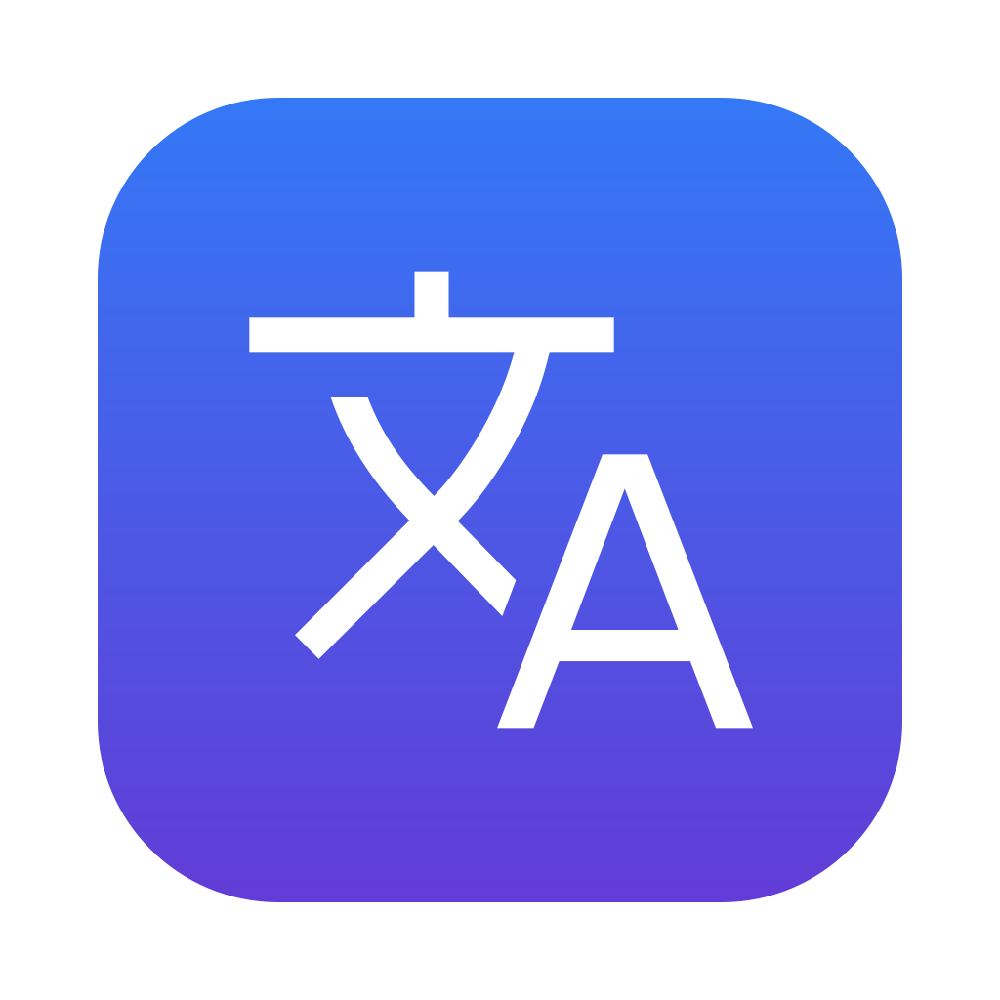

<p align="center">
  
</p>

<h1 align="center">PuntoLite</h1>

<p align="center">
  <b>Мгновенная смена языка на Mac — без задержки и пропущенных букв.</b><br>
  <b>Fix the Mac keyboard language switch delay — switch input source instantly.</b>
</p>

<p align="center">
  <a href="../../releases/latest"><b>⬇️ Скачать / Download PuntoLite.dmg</b></a>
  &nbsp;·&nbsp; <a href="#english">English</a>
</p>

---

## Не переключается язык на Mac? Переключается с задержкой?

Самая частая жалоба пользователей Mac: нажимаешь **кнопку смены языка (🌐 / Fn или Caps Lock)**, начинаешь печатать — а первые буквы уходят **на старом языке**. Язык то переключается, то нет, то с задержкой в полсекунды.

Это не поломка. macOS **специально притормаживает** кнопку смены языка, чтобы отсеять случайные нажатия. При быстром наборе эта задержка съедает первые символы, и текст печатается не на том языке.

**PuntoLite убирает задержку.** Кнопка 🌐 / Fn переключает язык **сразу, с первого нажатия**. Работает с любыми языками и раскладками, а после настройки — даже когда приложение закрыто.

### Возможности

| | Для кого | Что делает |
|---|---|---|
| **Fn (🌐) — мгновенная смена языка** | все | Убирает системную задержку при переключении раскладки. Любые языки: английский, русский, украинский, немецкий, испанский, китайский и т.д. |
| **Option (⌥) — исправить раскладку** | русский ⇄ английский | Исправляет текст, набранный не в той раскладке: `ghbdtn` → `привет`, `руддщ` → `hello`. Включается и выключается в меню |

**Исправление раскладки по Option** (только для пары русский + английский):
- **выделили текст** → он конвертируется в другую раскладку;
- **ничего не выделено** → PuntoLite находит в тексте до курсора слова, набранные не в той раскладке, и исправляет только их;
- нажали ещё раз → всё вернулось как было;
- не нужно — меню 文A → снимите галочку «Исправлять раскладку по Option».

Бесплатная замена **Punto Switcher** для Mac, который больше не поддерживается. Работает офлайн, ничего никуда не отправляет.

### Установка

1. [Скачайте **PuntoLite.dmg**](../../releases/latest), откройте и перетащите PuntoLite в «Программы».
2. Снимите блокировку macOS. Приложение бесплатное и не подписано в Apple, поэтому система помечает его как «загруженное из интернета». Откройте **Терминал** и выполните:
   ```bash
   xattr -dr com.apple.quarantine /Applications/PuntoLite.app
   ```
   Альтернатива без Терминала: запустите PuntoLite, затем **Системные настройки → Конфиденциальность и безопасность → внизу «Всё равно открыть»**.
3. Запустите PuntoLite. Появится сообщение «Кнопка смены языка перенастроена» — проблема исправлена.
4. Для исправления раскладки по Option разрешите доступ: **Конфиденциальность и безопасность → Универсальный доступ → PuntoLite**. Если пользуетесь только быстрой сменой языка, этот шаг не нужен.

PuntoLite живёт в строке меню (значок 文A), не занимает место в Dock и запускается вместе с Mac. Обновляется сам.

### Вопросы

**macOS пишет «PuntoLite повреждён» или «не удаётся проверить разработчика».** Выполните команду из шага 2 (`xattr -dr com.apple.quarantine /Applications/PuntoLite.app`) и запустите снова.

**Apple Silicon (M1–M4) и Intel?** Да, одна сборка. Нужна macOS 13 Ventura или новее.

**Fn+стрелки, Fn+F1–F12 работают?** Нет, кнопка Fn целиком отдана под смену языка. Вернуть как было: меню 文A → «Вернуть стандартную кнопку языка и выйти».

**Язык снова переключается с задержкой?** Меню 文A → «Починить кнопку смены языка».

**Платно?** Нет, бесплатно и с открытым кодом.

<sub>переключение раскладки mac, не переключается язык на макбуке, задержка смены языка macos, язык переключается не с первого раза, кнопка глобус fn смена языка, caps lock смена языка задержка, punto switcher для mac, аналог punto switcher, caramba switcher альтернатива, исправить раскладку, ghbdtn привет</sub>

---

<a id="english"></a>

## Mac keyboard language switch delay — fixed

Press the **Globe 🌐 / Fn key** (or Caps Lock) to change the input source on your Mac, start typing — and the first letters still come out in the **old language**? Language switching on macOS is **slow, laggy, or doesn't switch on the first press**?

That's by design: macOS adds a **deliberate delay to the input source switch key** to ignore accidental presses. When you type fast, that delay eats the first characters.

**PuntoLite removes the delay.** The Globe / Fn key switches the keyboard language **instantly, on the first press** — for **any language pair** (English, Spanish, German, French, Ukrainian, Chinese, Japanese…). Once set up, it keeps working **even when the app is closed**.

- ✅ Instant input source switching with the Globe / Fn key
- ✅ Works with any keyboard layouts and languages
- ✅ No lag, no missed first letters, no switching twice
- ✅ Free, open source, offline, tiny menu bar app
- ✅ Apple Silicon & Intel, macOS 13 Ventura and later

### Install

1. [Download **PuntoLite.dmg**](../../releases/latest), open it and drag PuntoLite to **Applications**.
2. Remove the macOS quarantine flag (the app is free and not notarized by Apple). Open **Terminal** and run:
   ```bash
   xattr -dr com.apple.quarantine /Applications/PuntoLite.app
   ```
   Or, without Terminal: launch PuntoLite, then **System Settings → Privacy & Security → Open Anyway**.
3. Launch PuntoLite. You'll see **"Language switch key fixed"** — done.

**"PuntoLite is damaged and can't be opened"?** Run the `xattr` command from step 2 and launch it again.

**Want the Fn key back?** Menu bar 文A → **Restore default Fn key and quit**.

<sub>mac keyboard language switch delay, macos input source switch lag, globe key language switch slow, fn key change language mac, caps lock language switch delay, macos keyboard layout switcher, switch input source instantly mac, language does not switch on first press mac</sub>

---

## Для разработчиков / For developers

- Release: **Actions → Release → Run workflow** → version number. Build, DMG and GitHub release are automatic.
- Local build: `bash scripts/build.sh --package` (Xcode Command Line Tools).
- Stable signing so Accessibility access survives updates: `bash scripts/make-cert.sh`, then add the two secrets it prints in Settings → Secrets → Actions.
- How it works: the Fn key is remapped to F18 via `hidutil` (kept by a LaunchAgent), and F18 is the system shortcut for "Select the previous input source". Layout fixing uses CGEventTap + Accessibility API + NSSpellChecker.
